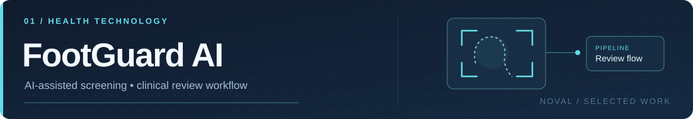
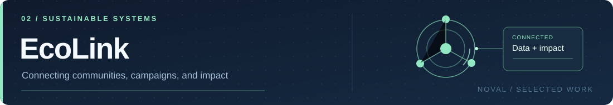
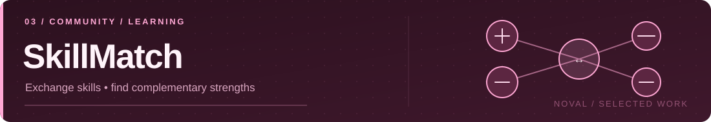

 

**Software developer / building for the web, the backend, and what comes next.**

[Explore projects](#selected-work) · [Toolkit](#toolkit) · [Activity](#activity) · [Portfolio repository](https://github.com/noval110/portfolio)

 

### 01 / A LITTLE CONTEXT

## I enjoy the space between *ideas* and *working software.*

I'm **Noval**, a developer in Indonesia, working across user interfaces, APIs, databases, and AI-assisted applications. I care about systems that are not just interesting to build, but genuinely useful to the people using them.

Right now, my focus is on **full-stack engineering**, strengthening my backend skills with **Go**, and exploring **AI engineering** through practical projects.

> Build thoughtfully. Keep learning. Ship things that work.

 

### 02 / SELECTED WORK

## Things I've been building

**[Explore FootGuard AI →](https://github.com/noval110/footguard-AI)**

AI-assisted diabetic foot screening and monitoring, connecting image analysis with a clinical review workflow. Designed as a support tool rather than a diagnosis system.

`React` &nbsp; `Go` &nbsp; `FastAPI` &nbsp; `PyTorch` &nbsp; `PostgreSQL`

 

**[Explore EcoLink →](https://github.com/noval110/ecolink)**

A platform exploring how community activities, sustainability programs, and impact data can work together through structured backend services.

`Go` &nbsp; `PostgreSQL` &nbsp; `Docker`

 

**[Explore SkillMatch →](https://github.com/noval110/skillmatch)**

A skill-sharing concept that helps people connect around what they can teach and what they want to learn.

`React` &nbsp; `Go` &nbsp; `PostgreSQL`

 

### 03 / TOOLKIT

## The technologies behind the work

| Area | What I work with |
|:---|:---|
| **Interface** | React, TypeScript, JavaScript, HTML, CSS, Vite |
| **Backend** | Go, REST APIs, authentication, service integration |
| **Data & AI** | PostgreSQL, Python, FastAPI, PyTorch |
| **Workflow** | Docker, Git, GitHub Actions, Vercel |

 

### 04 / BUILD LOG

## The work keeps moving

<b>View the animated contribution timeline</b>

 
<picture>
<source media="(prefers-color-scheme: dark)" srcset="https://raw.githubusercontent.com/noval110/noval110/output/github-contribution-grid-snake-dark.svg"/>
<source media="(prefers-color-scheme: light)" srcset="https://raw.githubusercontent.com/noval110/noval110/output/github-contribution-grid-snake.svg"/>

</picture>

 

---

`noval110` · **Curious by default. Building with purpose.**

[GitHub](https://github.com/noval110) · [Repositories](https://github.com/noval110?tab=repositories) · [Portfolio](https://github.com/noval110/portfolio)

