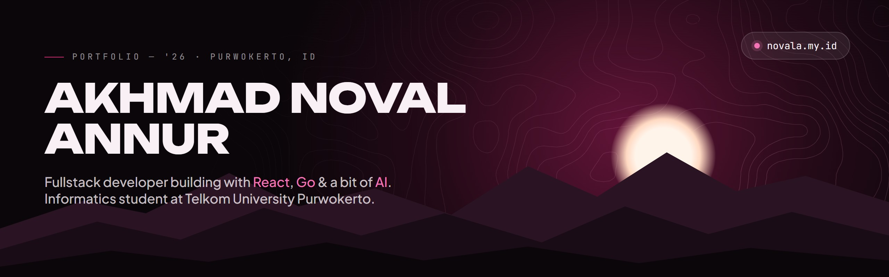
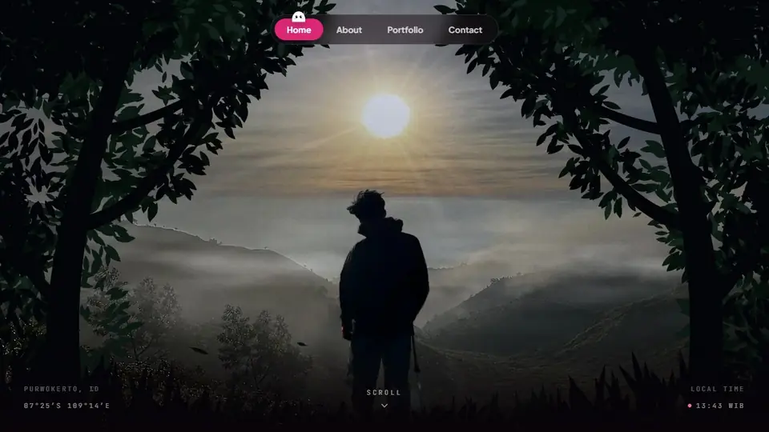
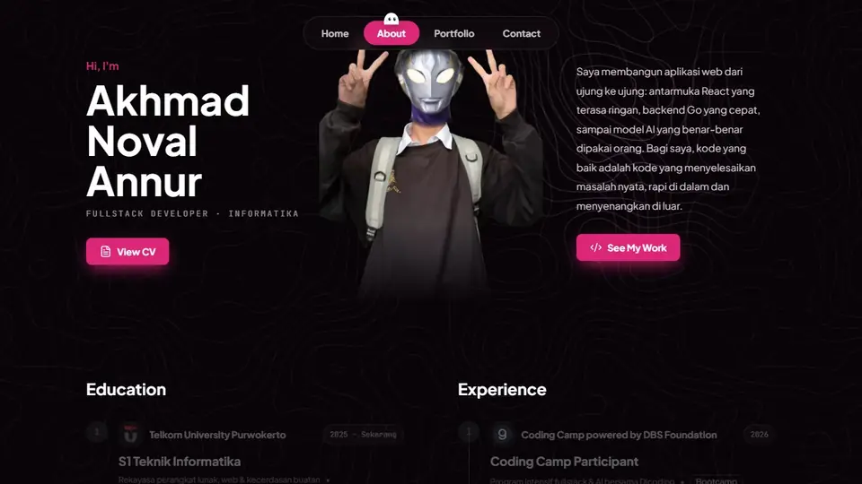
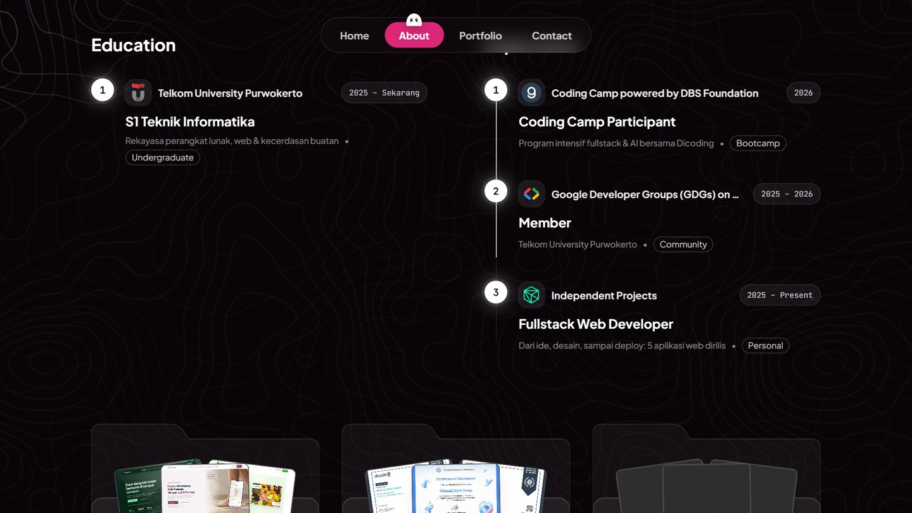
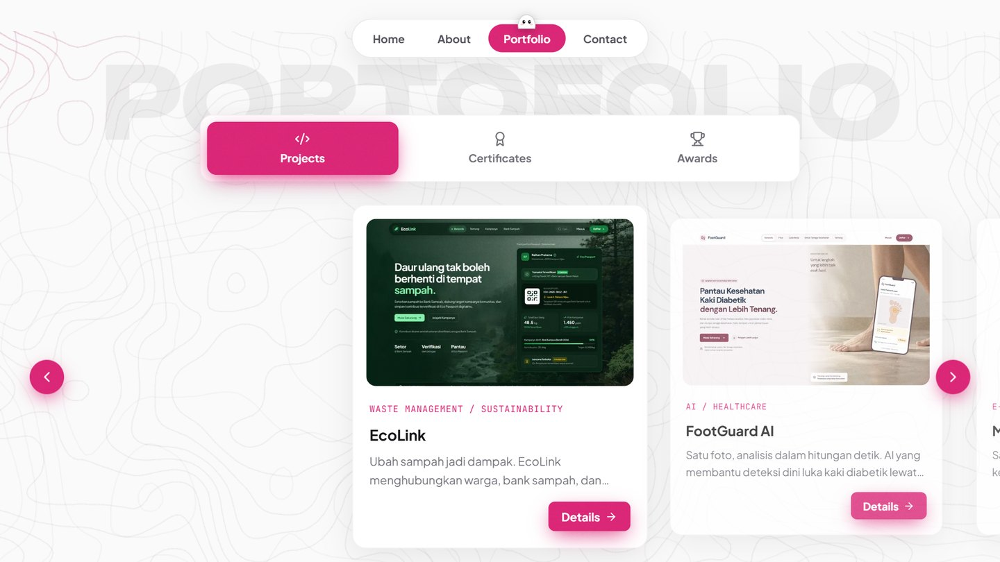
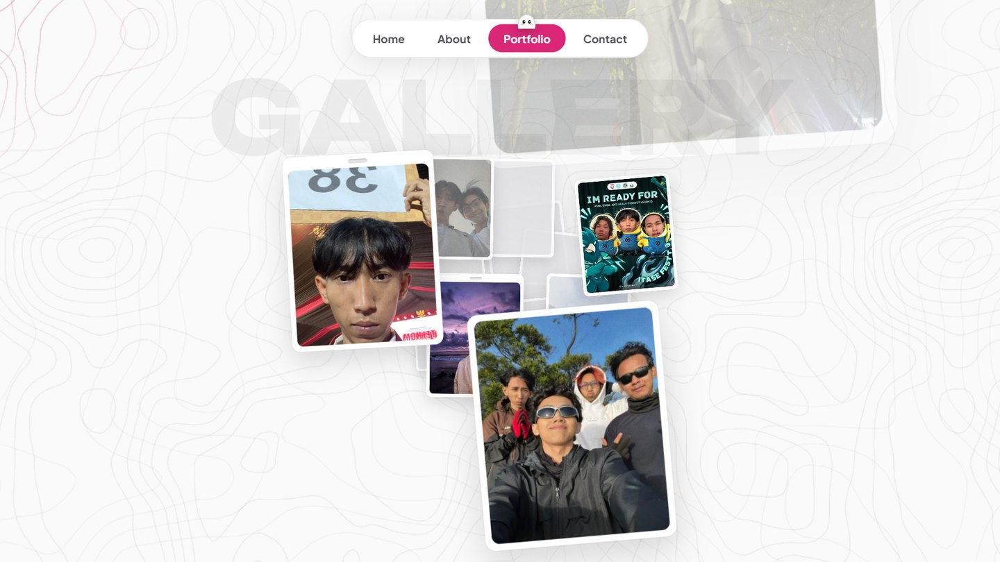
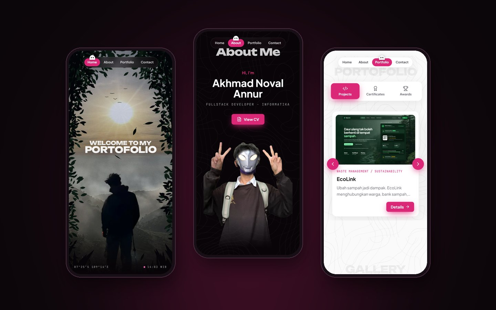

  

[The portfolio](#portfolio) · [Selected work](#selected-work) · [Toolkit](#toolkit) · [Build log](#activity)

 

### 00 / THE PORTFOLIO

## A website you scroll *through*, not just down.

Recorded from the live site — the letters hop in, the <b>O·F·O</b> keeps an eye on your cursor, leaves fall and birds cross the sky.

My portfolio is built like a short film: a sunrise I photographed on a hike becomes a layered parallax scene, and every section after it has its own small moment. A few of them:

<table>
  <tr>
    <td width="50%" valign="top">
      
       <b>The lens.</b> Hover the portrait and a circle follows the cursor, revealing a hero hiding in the same pose.
    </td>
    <td width="50%" valign="top">
      
       <b>The journey.</b> Education and experience light up one step at a time as you scroll, over a contour map that glows around your cursor.
    </td>
  </tr>
  <tr>
    <td width="50%" valign="top">
      
       <b>The work.</b> The word PORTOFOLIO zooms until its white fills the screen, then projects, certificates and awards slide by sideways.
    </td>
    <td width="50%" valign="top">
      
       <b>The gallery.</b> Photos from campus, hikes and late-night coding fly toward the camera in 3D.
    </td>
  </tr>
</table>

Made for phones too — every scene has its own portrait layout and touch interactions.

| Layer | Built with |
|:---|:---|
| **Interface** | React 19, TypeScript, Vite, Tailwind CSS |
| **Motion** | GSAP ScrollTrigger, Framer Motion, Lenis, canvas |
| **Backend** | Supabase — realtime comments, avatar uploads, contact inbox and a private admin panel |
| **Delivery** | Vercel, responsive WebP pipeline, reduced-motion support |

> [!NOTE]
> The source code is private, the website is not. **[Visit novala.my.id →](https://www.novala.my.id)**

 

### 01 / A LITTLE CONTEXT

## I enjoy the space between *ideas* and *working software.*

I'm **Noval**, an Informatics student at Telkom University Purwokerto, working across user interfaces, APIs, databases, and AI-assisted applications. I care about systems that are not just interesting to build, but genuinely useful to the people using them.

Right now, my focus is on **full-stack engineering**, strengthening my backend skills with **Go**, and exploring **AI engineering** through practical projects.

> Build thoughtfully. Keep learning. Ship things that work.

 

### 02 / SELECTED WORK

## Things I've been building

**[Explore FootGuard AI →](https://github.com/noval110/footguard-AI)** &nbsp;·&nbsp; [Live demo](https://footguard-ai.vercel.app/)

AI-assisted diabetic foot screening and monitoring, connecting image analysis with a clinical review workflow. Designed as a support tool rather than a diagnosis system.

`React` &nbsp; `Go` &nbsp; `FastAPI` &nbsp; `PyTorch` &nbsp; `PostgreSQL`

 

**[Explore EcoLink →](https://github.com/noval110/ecolink)** &nbsp;·&nbsp; [Live demo](https://ecolink-sigma.vercel.app)

Turning waste into impact: residents, waste banks and organisations connected through verified deposits, an AI waste classifier and a digital Eco Passport.

`React` &nbsp; `Go` &nbsp; `PostgreSQL` &nbsp; `FastAPI` &nbsp; `PyTorch` &nbsp; `Docker`

 

**[Explore SkillMatch →](https://github.com/noval110/skillmatch)** &nbsp;·&nbsp; [Live demo](https://skillmatch-noval7.vercel.app/)

Find competition teammates without guessing: people are matched by skills, role, interests and experience, with a compatibility score.

`React` &nbsp; `Go` &nbsp; `PostgreSQL`

 

### 03 / TOOLKIT

## The technologies behind the work

| Area | What I work with |
|:---|:---|
| **Interface** | React, TypeScript, JavaScript, HTML, CSS, Tailwind CSS, Vite |
| **Backend** | Go, REST APIs, authentication, service integration |
| **Data & AI** | PostgreSQL, Supabase, Python, FastAPI, PyTorch |
| **Workflow** | Docker, Git, GitHub Actions, Vercel |

 

### 04 / BUILD LOG

## The work keeps moving

<b>View the animated contribution timeline</b>

 
<picture>
<source media="(prefers-color-scheme: dark)" srcset="https://raw.githubusercontent.com/noval110/noval110/output/github-contribution-grid-snake-dark.svg"/>
<source media="(prefers-color-scheme: light)" srcset="https://raw.githubusercontent.com/noval110/noval110/output/github-contribution-grid-snake.svg"/>

</picture>

 

---

`noval110` · **Curious by default. Building with purpose.**

[Portfolio](https://www.novala.my.id) · [LinkedIn](https://www.linkedin.com/in/akhmad-noval-584025383) · [Repositories](https://github.com/noval110?tab=repositories) · [Email](mailto:novalahmadanur@gmail.com)

